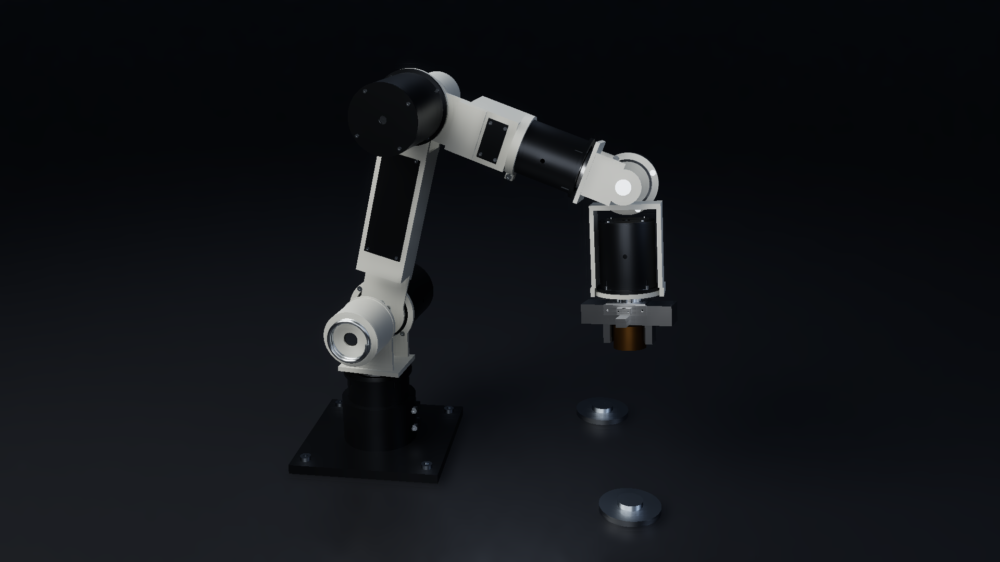
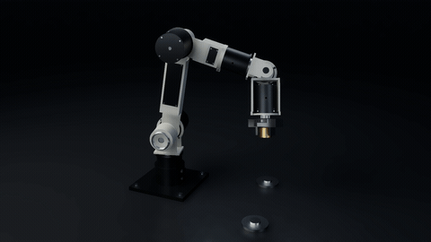
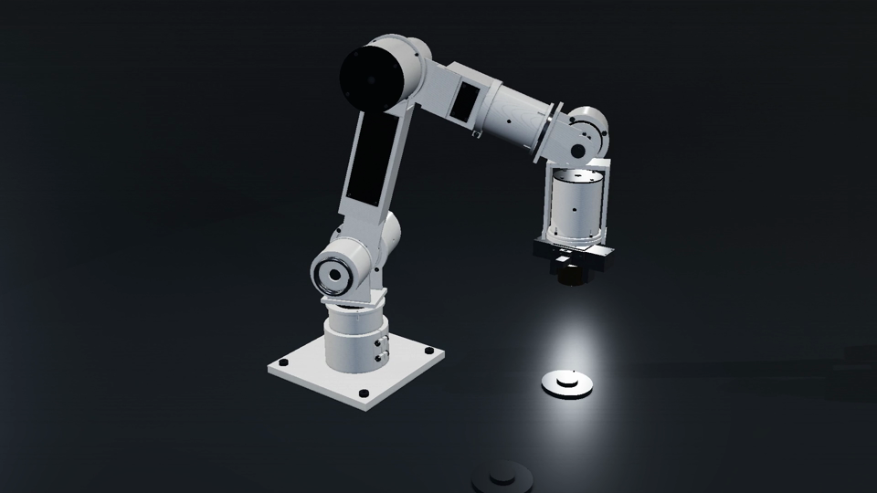
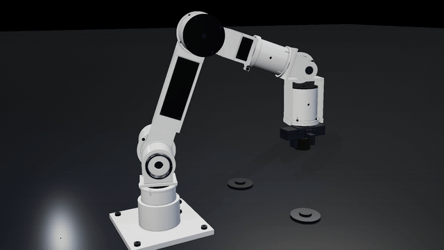
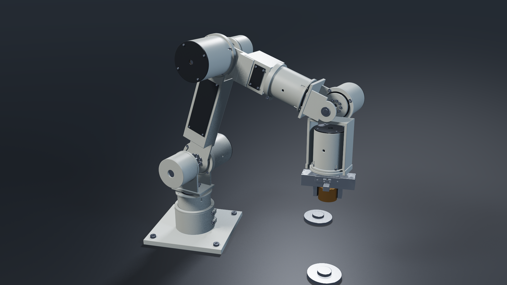
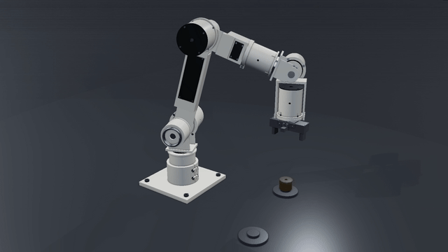

# ARX / 6 · compact-cartridge P5

Constructive CAD, reconstructed contact dynamics, and three preserved cinematic editions of a 278-part compact robot arm. This is a concrete mechanism example, not a separate general-purpose geometry framework and not qualified physical hardware.





**Latest: the 12-second native CPU Monte Carlo film**, 1920×1080 at 24 fps, with 288 distinct decoded frames. The GIF is a 480-pixel, 10 fps derivative of the entire original movie. A two-second reveal precedes the ten-second contact action with camera cuts. It contains no staged disassembly and adds no new mechanical validation. [Watch/download the original MP4](media/ARX6-P5-Pathtraced-Action-1080p.mp4).

The later renderer implements two-level BVHs, diffuse/GGX sampling, finite area emitters, multiple importance sampling and geometry-guided denoising. The design, mass records and contact capture are byte-identical to the earlier films. [Read the renderer architecture, limitations and fresh-checkout instructions](pathtraced/README.md). Restore its exact packaged geometry data before building or running: `python3 pathtraced/tools/restore_native_cache.py`. All required cache bytes are included, with no private input dependency.

## Preserved raster editions and mechanism source

The recovered 278-part compact-arm constructive CAD and cinematic source. Six integrated drive cartridges and enclosed torsion counterbalances are represented by an explicit CSG part model, rebuilt with OpenCascade, animated from a contact simulation, and rendered using VTK PBR shading.





The earlier restored v2 film is 15 seconds, 1920×1080, 24 fps, with 360 distinct decoded frames. The still is its one-second frame; the GIF covers seconds 7–15 at 640 pixels / 10 fps. These are native CAD renders, not physical hardware or generated concept artwork. The staged offsets are not a validated real-life disassembly procedure.

[Watch/download the restored v2 short cut](media/ARX6-P5-Cinematic-v2.mp4) · [Preserved v1 28-second film, exact byte parts](media/ARX6-P5-Cinematic-v1.mp4.parts/)

The v2 package describes a fresh restoration from retained source and recorded edits, not recovery of original encoded v2 bytes. This publication did not rerender it. The v1 hero and contact-action excerpt remain available below.

## What is here

- `assets/design.json`: unchanged constructive source for 278 part instances, with stable IDs/names, body ownership, CSG trees, materials, roles, finishes, bounds, display explosion offsets, drive records and counterbalances.
- `assets/mass-properties.json`: recovered body mass, center-of-mass and inertia data.
- `assets/meshes/`: 278 cached native tessellations, so rendering does not require repeating CAD generation.
- `assets/capture.json`: a retained reconstructed ten-second contact solve sampled at 120 Hz.
- `source/build_meshes.py`: CadQuery/OpenCascade evaluation and mesh generation.
- `source/capture-model.xml`, `capture-parameters.json`, `reference.mjs`, `capture.mjs`: reconstructed MuJoCo model and controller.
- `source/native_film.py`, `geometry.py`, `finalize_film.py`: physical-pose sampling, VTK PBR rendering, six-shot camera edit and media verification.
- `source/native_film_v2.py`, `render_delivery_v2.py`, `complete_pending_v2.py`: restored lighting/staging and resumable 15-second cut; shared geometry and capture are unchanged.
- `reports/`: historical v1 capture, native geometry, shot and decoded-video evidence; `reports/v2/` preserves the later short-cut reports.
- `docs/cinematic-v2/`: original v2 package notes and an explicit source/output-path mapping.
- `media/`: the complete v2 film, lossless parts for the complete v1 film, and source-derived images/GIFs.
- `source/runtime/`, `licenses/`: bundled MuJoCo WASM 3.16.0 and its notices.

This is a distinct historical compact design, not an overlay for the belt-drive P5. Its source is useful as a concrete mechanism example; it is not a second general-purpose geometry framework.

## How geometry and motion are connected

`design.json` is a constructive tree/DAG using `box`, `cylinder`, `polygon`, `helix`, `transform`, `union`, `cut` and `intersection`. `build_meshes.py` constructs native solids, then tessellates them at 0.045 mm linear / 0.12 rad angular deflection. The original report records 278 valid solids and 778,046 triangles. Tessellation settings are rendering inputs, not manufacturing tolerances.

Part instances map to articulated body names. `geometry.py` samples body poses from the capture and applies part transforms for rendering. The model has six hinge joints, opposing slider jaws, an equality constraint for jaw synchronization, a rack-pinion tendon, and an independent free puck. Explicit pad/puck contact and friction carry the payload; it is not welded or script-attached to the hand.

`capture.mjs` supplies computed-torque/PD arm control, bounded force-controlled jaw drive, and screening torsion-spring torques. The reference is a control target, not a replacement for the integrated puck trajectory.

## What changed in v2

The short cut is reveal (0–3 s), the first four seconds of the recorded action (3–7 s), staged inspection (7–12 s), and reverse offsets/reassembly view (12–15 s). It omits the remainder of the ten-second pick/return cycle.

The renderer changes procedural HDR lighting, PBR material settings, three scene lights, 2048-pixel shadow maps, a 32-sample SSAO render pass and filmic tone mapping. Depth of field is bypassed. Component group/role heuristics stagger the saved explosion offsets and provide fallback offsets for parts with zero stored displacement. No geometry, mass properties, mesh cache, contact capture or electromechanical model was changed.

These staging heuristics do not model fastener unscrewing/thread engagement, supported loads, spring unloading, press fits, retained joints, cable disconnection, tool access or collision-free extraction. Reverse offsets are a presentation effect, not an assembly plan.

## Restore the preserved v1 film

The historical v1 MP4 is stored in exact byte parts to fit the publication transport limit. Before working with a fresh checkout, run:

```bash
python3 tools/restore_original_film.py
```

This standard-library helper verifies each part and restores the original 13,128,405-byte `media/ARX6-P5-Cinematic-v1.mp4` without transcoding or changing any frame. Its SHA-256 is `e8873fec1763941dd100e96727d91d1a1b1f2ec60fc429416c7ee1e06141e11a`. It refuses to overwrite a different existing file. All bytes are included locally; no private inputs or network service are needed. The v2 and path-traced MP4s and all three GIFs remain directly playable without restoration. The restored raw v1 movie is ignored by Git because its parts are tracked.

## Run

Use Linux EGL/OpenGL, Node.js, FFmpeg/ffprobe and the pinned Python requirements. The original capture used MuJoCo WASM 3.16.0. Installation and rendering were not rerun as part of this publication review.

From the repository root:

```bash
python3 tools/restore_original_film.py
python3 -m venv .venv
. .venv/bin/activate
python3 -m pip install -r requirements.txt
mkdir -p shots reports
# Optional: replace the stored capture with a fresh reconstructed solve.
node source/capture.mjs
python3 source/inspect_capture.py
# The packaged mesh cache is ready to use.
OPENBLAS_NUM_THREADS=1 LP_NUM_THREADS=4 python3 source/native_film.py --still --width 960 --height 540
OPENBLAS_NUM_THREADS=1 LP_NUM_THREADS=4 python3 source/native_film.py --width 1920 --height 1080 --fps 24
python3 source/finalize_film.py
```

The commands above reproduce the v1 longer-cut pipeline. For the restored **v2 15-second short cut**, preserve the packaged capture and run:

```bash
python3 source/complete_pending_v2.py
```

This uses at most two render workers, reuses stored frames, writes `frames-v2/`, `clips-v2/` and `reports/v2/`, and produces `ARX6-P5-Cinematic-v2.mp4` in the repository root. Existing v2 report files describe the supplied movie until a local run replaces them. Do not mix cached frames from different source revisions. Manual batches use `python3 source/render_delivery_v2.py --worker SHOT START END`, with END exclusive; total ranges are shot 0: 0–72, shot 1: 0–96, shot 4: 0–120, shot 5: 0–72. `python3 source/render_delivery_v2.py --finish` encodes all completed frames and checks 360 distinct decoded frames. The direct `native_film_v2.py` CLI retains longer-cut defaults; it is not the short-cut entrypoint.

Use `--shot 0` through `--shot 5` to render one shot. The full edit is reveal, continuous pick/transfer/return, precision grip, elbow detail, exploded architecture and reassembly hero.

To regenerate tessellations, first move or remove the cached `assets/meshes/*.npz` in a working copy, then run `python3 source/build_meshes.py`. The script skips existing cache files; an all-cache-hit invocation is not a fresh geometry validation. The experimental constructive ray-query compiler in `geometry.py` is not the production film renderer.

## What this does not validate

The original compact P5 nominal trajectory and full electromechanical validation were not present in the recovered cinematic inputs. The included capture is a later reconstruction using recovered dimensions and mass tensors. It does not reproduce the original electrical controller, 28-scenario validation, motor-current limits, thermal qualification or functional safety. No such results from the separate belt model should be attributed to this design.

- Capture joint ranges are broad reconstruction bounds, not qualified hardware travel limits.
- Contact proxies cover nests, jaw pads and puck; complete robot self-collision is not reproduced.
- Counterbalance torques use a linear screening model. The displayed coils retain their reference geometry rather than flexibly deforming.
- Exploded/reassembly motion uses presentation offsets. It is not a collision-checked physical assembly/disassembly sequence.
- Purchased components are envelope representations. Supplier interfaces, tolerance stackups, spring winding/preload/fatigue, structural loads and hardware commissioning remain unqualified.
- V2 revises cinematic lighting and staging, but physically accurate disassembly/reassembly remains unvalidated.

The archived capture review reports finite states, a monotonic 120 Hz timeline, matching recovered body inertia records and an unwelded free puck. Those are integrity observations, not hardware certification. Publication review checked the supplied source/data and decoded the media; it did not rerun the simulation or renderer.

## Preserved v1 imagery





The v1 GIF is derived from seconds 3–8 of the 28-second, 672-frame film. It uses the same native geometry and reconstructed capture as v2; it is not the original single-pass GLSL renderer.

## Provenance and rights

The constructive source remains SHA-256 `48b3dcf993f78a9e1f386c8458644bb5829d627c895b88e58e616ae14aa565a0`. The separately recovered design and mass-property files match the copies in the cinematic archive byte-for-byte. This repository preserves both cinematic revisions, without overlaying the incompatible belt-drive source. The v2 design, mass properties, capture and all shared source/runtime/mesh inputs match v1 byte-for-byte. The [revision map](docs/cinematic-v2/SOURCE-MAP.md) documents the three v2 source additions and path-only packaging changes. Historical reports have not been relabeled as new physics validation.

No project-wide license grant was present, so none is added. MuJoCo retains its Apache-2.0 license and third-party notices under `licenses/`. Other dependencies keep their own licenses. Public availability is not a blanket license grant. The original package description remains in [PACKAGE-NOTES.md](PACKAGE-NOTES.md).
