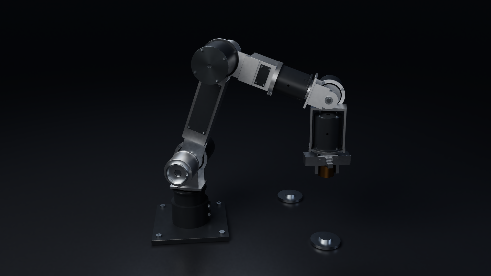
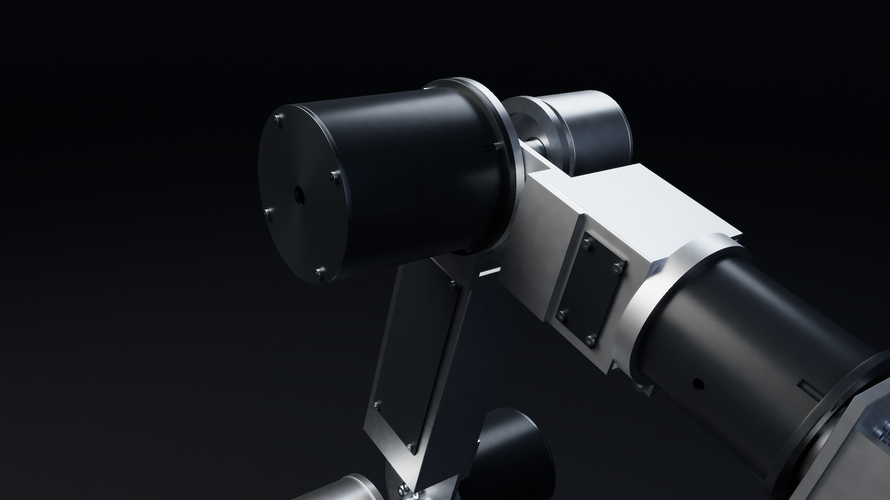

# P5 Refined: actual CAD and proof-render source

Recovered 2026-10-22 18:41 UTC edition. This is the real 278-part compact model with 123 BREP-refined instances, not a new whole-arm validation or action film. The original delivered documentation is preserved verbatim in [ORIGINAL-README.md](ORIGINAL-README.md). Its actual source, engineering reports, images and inputs are retained.




The native masters are `renders/ARX6-P5-Refined-hero-4K.png` and `renders/ARX6-P5-Refined-closeup-4K.png`. The supplied reference close-up is a resampled copy of the latter, not a new P6 image. See [media provenance](../MEDIA-SOURCE-MAP.md).

## Fresh checkout: restore first

The two native geometry caches and operating-pose STEP are transported as deterministic gzip byte parts to remain below the GitHub transfer limit. They are not reduced or quantized. Run from this revision directory before the original build/render instructions:

```sh
python tools/restore_packaged_data.py
```

The helper uses only Python's standard library, checks every part, compressed stream and exact restored hash, and restores the original `assets/native.bin`, `assets/refined-native.bin` and `cad/ARX6-P5-Refined-operating-pose.step` paths. It refuses to replace different existing files. `--verify-only` checks roundtrips without writing outputs. Expected hashes and byte counts are in [PACKAGED-DATA.json](PACKAGED-DATA.json). The source code does not need private files to read these supplied inputs.

Create an isolated environment and install the source-delivered `requirements.txt`; Python 3.11+ is a practical starting point for its pinned package family, but dependency installation was not verified in this publication review. A C++17 compiler with OpenMP is needed. The complete original commands, caching behavior and numerical limits are in ORIGINAL-README.md. No archived compiled renderer is included. Rebuild it before rendering:

```sh
g++ -O3 -march=native -fopenmp -std=c++17 source/pathtrace.cpp -o source/pathtrace
g++ -O2 -fopenmp -std=c++17 source/test_refined.cpp -o source/test_refined
```

The original test executable and `python source/render_proofs.py` are subsequent user-run steps, not tests executed during publication. Retained proof images/reports and CAD checkpoints may cause original scripts to skip work. Use a separate fresh output workspace or deliberately remove only intended regenerated outputs after preserving evidence; an all-cache-hit invocation is not fresh geometry or rendering validation.

## Honest engineering scope

The original final envelope screen records no added material outside old component bounds. The earlier rejected envelope screen remains included. STEP reimport/solid checks do not qualify strength, fits, tool access, continuous swept collision, fatigue or powered operation. Multi-solid reference coils are inherited. The mass change is about -4.91667 g, and dynamics were not revalidated for these refinements.

All original engineering source bytes are unchanged. Only three report path strings were normalized for publication; the original hashes and exact changes are listed in [PUBLICATION-CHANGES.json](PUBLICATION-CHANGES.json). The original archive hash map is [ORIGINAL-ARCHIVE-SHA256.json](ORIGINAL-ARCHIVE-SHA256.json), whose paths refer to that archive layout, not the Git transport layout. No new project license is granted. Later [P6-A evidence](../p6-a-petg/README.md) and [P6-B prototypes](../p6b-print-first/README.md) remain separate revisions.
