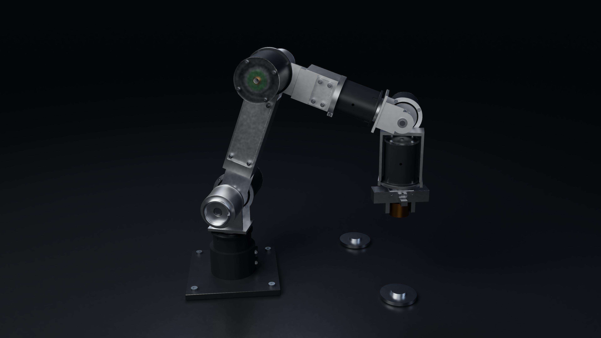
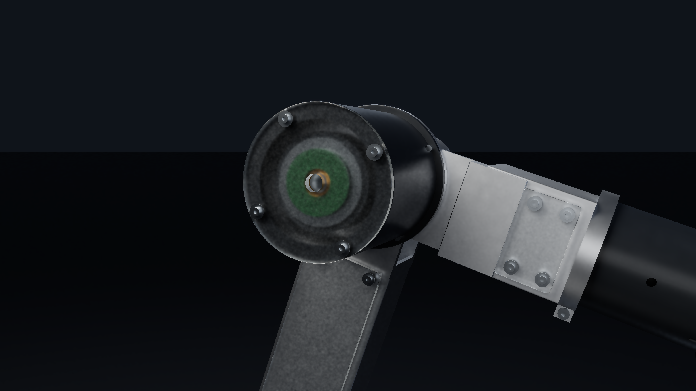

# P6-A PETG: authentic evidence, incomplete implementation recovery

This 2026-10-22 19:39 UTC delivery documents a 398-instance metal-core arm with ten PETG covers/panels and associated mounting details. It is not the later print-first structural redesign or a completed all-printed arm.




Included: authentic operating-pose STEP, engineering PDF, review HTML, verification JSON and two native 4K proof images. The supplied reference hero is a resampled version of this hero, not proof of a newer mechanism generation. See [the media/source map](../MEDIA-SOURCE-MAP.md).

## Missing source, precisely

The referenced `ARX6-P6-PETG-Source-and-CAD.zip` is still unavailable. Its historical verification reports 126,606,156 bytes and SHA-256 `d183f1cc6e604bb58ab557b8dd5e53a4ca70239fb76c289743222f7c5c409b06`; the archive's claimed 594 members have not been inspected. A filename, hash, posed STEP or image is not the implementation.

Missing source-reported modules include `build_p6.py`, `update_dynamics.py`, `capture.mjs`, `audit_geometry.py`, `screen_covers.py`, `refine_fea.py`, `engineering_screen.py`, `export_p6_native.py`, `pathtrace.cpp`, `test_optics.cpp`, `render_petg_proofs.py`, `build_documents.py` and `verify_package.py`. The review HTML is a report/table filter, not embedded CAD, solver or optical source. No fresh-checkout command can honestly reconstruct those missing algorithms from this directory.

## Restore the authentic STEP

Run from this directory:

```sh
python tools/restore_packaged_data.py
```

The stdlib-only helper verifies the lossless gzip part and restores `ARX6-P6-PETG-operating-pose.step` with exact SHA-256 `d221151100211932e8b1251d18ae299ead2a07949f98be8cd34465305ab1b97d`. `--verify-only` checks without writing. [PACKAGED-DATA.json](PACKAGED-DATA.json) retains all transport/output hashes. This exposes the genuine assembled geometry, not a parametric source substitute.

## Failure evidence remains part of the result

The reports describe 50 replacements and 120 additions over 278 baseline instances, ten PETG covers and 40 mount sites. Main structural load paths remain metal. Their mass increase is about 53.516 g. Historical candidate overlap screening is not full continuous collision qualification.

The dossier retains failed initial hole-clearance cases, controller changes after excessive jaw excursion, and thermal failures: **25/40 cases exceed the 55°C screen**, including large covers around 58–67°C under an assumed 85°C metal case/25°C ambient scenario. Cover FEA uses assumed orthotropic material data and retains higher-load failures and mesh sensitivity. Creep is compliance sensitivity, not a measured life prediction. Optical haze/absorption/scattering values are appearance assumptions, not measured print clarity. These are conditional prototypes, not a manufacturing or powered-safety release.

The later [P6-B source](../p6b-print-first/README.md) supplies genuine structural/gear prototype builders and source inputs, including P6-A replacement-property records. It does not restore these missing P6-A CAD/controller/FEM/thermal/optical algorithms or retroactively resolve the failed checks. No new license grant is added.
